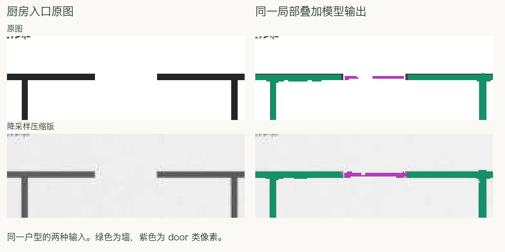

# 补充 M2-DA 将无门通道标为 door 的回归样例

作者你好，我们在 LayoutSculpt 中使用了 v1.0.0 的 M2-DA 权重，把户型图转换为三维模型。这次想贡献一个可以独立检查的样例：走廊与厨房之间有一个 0.9 米宽的通道。绘图时在这里留了开口，两侧墙端清晰；同图中实际有门的位置另外画了门扇和开启弧线。

在我们的 CPU 推理流程中，通道两端的墙体之间出现了多处高置信度的 `door` 像素。下游如果直接用这个信号放置门扇，就会给敞开的厨房入口多装一扇门。我们在三维生成前会对照原图复核，这次最终成品保留了通道。

## 如何复现

1. 使用 v1.0.0 发布的 `M2_DA_FT_v2_best.pt`。本次使用由该权重导出的 ONNX，在 ONNX Runtime 1.23.2 的 CPU 后端运行。
2. 分别输入[合成原图](threebed.png)和[同图的降采样压缩版](scanthree.png)。整图转 RGB，双线性缩放到 512 × 512，按 ImageNet 均值和标准差归一化。对 logits 做 softmax，仅保留最大类别概率 ≥ 0.80 的像素。
3. 在 512 × 512 输出中查看厨房开口。以左上角为坐标原点，统计窗口为 `mask[287:292, 289:322]`，即 5 行 × 33 列。

| 输入 | 厨房开口中心（输入图像坐标） | 窗口内标为 door 的像素数 |
|---|---:|---:|
| 1440 × 1020 原图 | (860, 575) | [47 / 165](threebed-mask.png) |
| 780 × 552 压缩版 | 约 (466, 311) | [71 / 165](scanthree-mask.png) |

期望在这个无门扇的开口处抑制门候选，同时保留同图中有门扇和开启弧线的真实门。两张输入来自同一个合成户型，复现范围是上述 ONNX 推理流程。项目原生 PyTorch 推理和其他户型仍待验证。

建议先把这组原图、分割输出和位置标注收作回归样例，供后续调整模型或门候选后处理时对照。请问上游对这种无门洞口的标注约定是什么？如果模型的 `door` 类本来就包含这类开口，这组对照也可以作为从分割结果生成门扇时的使用说明。
